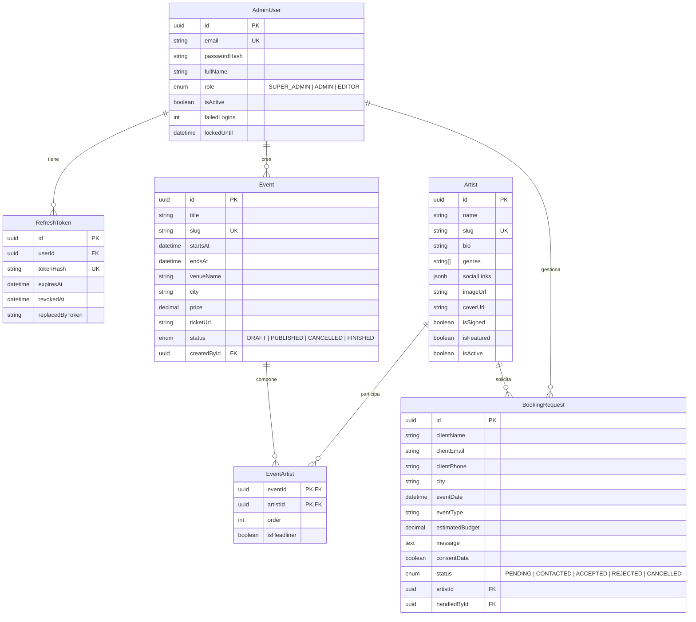

# 🎵 Money-Stack

Plataforma web y sistema de gestión integral para sello discográfico independiente, catálogo de talentos, agenda de eventos y sistema de bookings musicales (Caucasia, Antioquia, Colombia).

---

## 📌 Tabla de Contenidos

- [Descripción General](#-descripción-general)
- [Arquitectura del Proyecto](#-arquitectura-del-proyecto)
- [Tecnologías y Stack](#-tecnologías-y-stack)
- [Dirección Visual y Estilo (Depth Map & Night Vision)](#-dirección-visual-y-estilo)
- [Estado y Hoja de Ruta (Roadmap)](#-estado-y-hoja-de-ruta-roadmap)
- [Seguridad Implementada](#-seguridad-implementada)
- [Catálogo Completo de Endpoints](#-catálogo-completo-de-endpoints)
- [Modelo de Datos](#-modelo-de-datos)
- [Guía de Instalación y Ejecución](#-guía-de-instalación-y-ejecución)

---

## 📖 Descripción General

**Money-Stack** centraliza y profesionaliza la operación de un sello discográfico independiente en el Bajo Cauca antioqueño:
- **Catálogo de Artistas:** Presencia digital de artistas firmados e invitados con perfiles multimedia, bio, enlaces a plataformas de streaming (Spotify, YouTube, SoundCloud) y redes sociales.
- **Cartelera de Eventos:** Conciertos, fiestas y festivales con gestión de lineups, artistas principales (*headliners*), orden en cartel, estado de venta y redirección segura de tickets.
- **Sistema de Contratación (Bookings):** Formulario público para promotores y eventos privados con validación anti-spam honeypot, aceptación obligatoria de tratamiento de datos según la Ley 1581 de 2012 de Colombia y seguimiento de cotizaciones.
- **Panel Administrativo RBAC:** Panel de control con roles jerárquicos (`SUPER_ADMIN`, `ADMIN`, `EDITOR`) para operar el catálogo, la agenda y las solicitudes sin exponer datos sensibles.

---

## 🏛 Arquitectura del Proyecto

El repositorio está organizado como un monorepo modular:

```text
Money-Stack/
├── backend/                   # API REST en Node.js + Express + Prisma (PostgreSQL)
│   ├── prisma/
│   │   ├── migrations/        # Historial de migraciones SQL versionadas
│   │   ├── schema.prisma      # Esquema relacional con índices y claves foráneas
│   │   └── seed.js            # Semilla para el primer SUPER_ADMIN
│   ├── src/
│   │   ├── config/            # Variables de entorno validadas con Zod
│   │   ├── controllers/       # Controladores envueltos en asyncHandler
│   │   ├── lib/               # Cliente Prisma unificado
│   │   ├── middlewares/       # authenticate, authorize, rate limiters, errorHandler, honeypot
│   │   ├── routes/            # Rutas públicas y de administración (/api/v1)
│   │   ├── services/          # Lógica de negocio y persistencia en base de datos
│   │   ├── utils/             # AppError, paginación, hashing HMAC/bcrypt, formato COP
│   │   ├── validators/        # Esquemas Zod .strict() por entidad
│   │   ├── app.js             # Express app, helmet, CORS, cookies, rutas
│   │   └── server.js          # Arranque, purga periódica de tokens y graceful shutdown
│   ├── .env.example           # Plantilla de entorno backend
│   └── package.json
├── frontend/                  # Aplicación Next.js 16 (App Router) + TypeScript
│   ├── src/
│   │   ├── app/
│   │   │   ├── (public)/      # Rutas públicas (Home, Artistas, Eventos, Booking, El Sello, Style Tile)
│   │   │   ├── admin/         # Panel administrativo privado (Login, Dashboard, Artistas, Eventos, Bookings, Usuarios)
│   │   │   ├── globals.css    # Directivas Tailwind v4, tokens y capas night-vision
│   │   │   └── layout.tsx     # RootLayout con QueryProvider y tipografía
│   │   ├── components/        # VisorFrame, DepthHero, MotionFade, NightVisionOverlay, Cards, Formularios
│   │   ├── hooks/             # useAuth (gestión de sesión y token en memoria)
│   │   ├── lib/               # Clientes API (browser y RSC con ISR), types, formateadores COP
│   │   └── styles/tokens.css  # Tokens visuales CSS (--depth-*, --accent, --text-*)
│   ├── next.config.ts         # Configuración Next.js con soporte de imágenes remotas HTTPS
│   ├── .env.example           # Plantilla de entorno frontend
│   └── package.json
├── AGENTS.md                  # Especificación maestra y contexto de arquitectura
└── README.md                  # Documentación global del proyecto
```

---

## 🛠 Tecnologías y Stack

### Backend
- **Node.js 20+** & **Express 4.21** (CommonJS estricto con arquitectura por capas: routes → controllers → services)
- **PostgreSQL** & **Prisma ORM 6** (migraciones declarativas, índices compuestos y transacciones serializables)
- **Zod 3** (validación de esquemas estrictos con rechazo de campos desconocidos `.strict()`)
- **JSON Web Tokens (JWT)** & **Bcrypt** (tokens en memoria, refresh tokens rotativos con HMAC-SHA256 en BD)
- **Helmet, CORS, Cookie-Parser** & **Express Rate Limit** (limitadores separados para login, refresh y bookings)

### Frontend
- **Next.js 16** (App Router, Turbopack, Server Components con ISR)
- **React 19** & **TypeScript**
- **Tailwind CSS 4** con Tokens de Diseño en CSS Variables
- **TanStack Query v5** (gestión asíncrona de caché y sincronización en panel admin)
- **Motion** (animaciones fluidas respetuosas de `prefers-reduced-motion` y modo estático)
- **Three.js** (renderizado diferido del mapa de profundidad en el hero)

---

## 🎨 Dirección Visual y Estilo

El proyecto implementa una estética **Depth Map + Night Vision**:
1. **Espectro de Profundidad:** El brillo codifica la cercanía espacial. Lo cercano es más claro y nítido (`--depth-3` a `--depth-5`), mientras que el fondo abisal y lejano es más oscuro y difuso (`--depth-0` a `--depth-1`).
2. **Acento Único Fosforescente:** Un solo color acento neón-menta (`#7dffb3`) para focalizar la atención y emular visores HUD militares/técnicos.
3. **Tipografía HUD:** Textos técnicos, metadatos y coordenadas en monoespaciada con tracking abierto; textos editoriales en sans-serif de alta legibilidad.
4. **Capas Ópticas Desactivables:** Grano sutil (ruido analógico), líneas de escaneo (*scanlines* en `::before`) y viñeta perimetral suave (*vignette* en `::after`). Todas respetan `prefers-reduced-motion` y cuentan con un interruptor interactivo `◉ FX` que conmuta la clase `html.fx-off`.
5. **Marcos Visor Tácticos (`VisorFrame`):** Contenedores con corchetes en esquinas (`┌ ┐ └ ┘`), telemetría geográfica de Caucasia (`07°59'N 75°12'W`) y barras de estado.
6. **Accesibilidad WCAG AA:** Todas las combinaciones de contraste superan 4.5:1 (con pares principales superando el estándar AAA de 7.0:1).
7. **Página Style Tile F0:** Disponible en `/style-tile` para auditar la paleta, contrastes y componentes en vivo.

---

## 🗺 Estado y Hoja de Ruta (Roadmap)

### Backend
- [x] **Fase 1: Core de Autenticación y Sesiones:**
  - Login con email normalizado, bloqueo anti-fuerza bruta tras 5 intentos por 15 minutos.
  - Refresh tokens rotativos en cookie httpOnly `ms_refresh`, hash HMAC en base de datos y ventana de gracia para evitar condiciones de carrera (`REFRESH_RACE` 409).
  - Logout local y global (`logout-all`), consulta de sesión activa `/me`.
  - Tareas programadas en servidor: purga periódica cada 24 horas de tokens vencidos.
- [x] **Fase 2: Gestión de Administradores:**
  - CRUD administrativo accesible exclusivamente por `SUPER_ADMIN`.
  - Cambio y reseteo de contraseñas con validación de contraseña anterior y reglas estrictas de 12+ caracteres.
  - Transacciones con aislamiento Serializable y prevención de colisiones (`CONCURRENT_UPDATE` 409).
- [x] **Fase 3: Artistas:**
  - Catálogo público (`GET /artists`, `GET /artists/:slug`) con filtros por género, destacados y búsqueda.
  - CRUD administrativo para roles `EDITOR+`, slugs automáticos anti-colisión y desactivación lógica (`isActive: false`).
- [x] **Fase 4: Eventos:**
  - Agenda pública (`GET /events`, `GET /events/:slug`) restringida estrictamente a eventos publicados (`PUBLISHED`), con orden cronológico y detección de cancelados (410).
  - CRUD administrativo de eventos y endpoint de cartelera (`PUT /admin/events/:id/lineup`).
- [x] **Fase 5: Bookings y Contrataciones:**
  - Endpoint público de contratación (`POST /bookings`) con campo trampa *honeypot* anti-bots, consentimiento explícito de datos personales y registro de IP.
  - Gestión administrativa de solicitudes (`GET|PATCH /admin/bookings`), notas internas y control estricto de transiciones de estado.

### Frontend
- [x] **F0: Style Tile & Design System:** Tokens CSS, tipografía display/body, auditoría WCAG AA y componentes base en `/style-tile`.
- [x] **F1: Cimientos y Arquitectura:** Next.js 16 con Turbopack, cliente API con token en memoria, gestión de refresh atómico, y QueryProvider.
- [x] **F2: Sitio Público con Datos Reales:** Páginas de Inicio, Catálogo de Artistas, Ficha de Artista, Agenda de Eventos y Detalle de Evento con ISR (`revalidate = 60`), `next/image` y estados de carga.
- [x] **F3: Efectos Firma:** Hero con efecto de profundidad en Canvas/Three.js con carga diferida, overlay night vision, marcos tácticos `VisorFrame` y conmutador accesible `EffectsToggle`.
- [x] **F4: Formulario de Bookings:** Formulario interactivo con desglose de campos, aceptación de Ley 1581, honeypot oculto y mapeo de errores de validación.
- [x] **F5: Panel de Administración (`/admin`):**
  - Autenticación segura y guardián de sesión.
  - Dashboard con métricas y accesos directos.
  - Gestión integral de artistas, eventos (con editor de lineup) y solicitudes de booking.
  - Gestión de usuarios y permisos (SUPER_ADMIN).
  - Mi Cuenta con cambio de contraseña seguro.
- [x] **F6: Rendimiento, Accesibilidad y SEO:** Metadatos dinámicos OpenGraph/Twitter, marcado semántico JSON-LD, enlaces skip-to-content y animaciones con `MotionFade`.

---

## 🔒 Seguridad Implementada

1. **Tokens en Dos Niveles:**
   - **Access Token:** JWT de corta duración (15 minutos) almacenado únicamente en memoria volátil de la aplicación frontend.
   - **Refresh Token:** Cadena criptográfica de alta entropía (7 días) enviada en cookie `HttpOnly`, `SameSite=Lax` y `Secure`. En la base de datos se almacena su hash HMAC-SHA256, imposibilitando la lectura directa ante volcados de datos.
2. **Defensa contra Reutilización de Tokens:** Al utilizar un refresh token, este se destruye y se genera uno nuevo. Si un token revocado es reutilizado fuera de la ventana de gracia, el sistema detecta la anomalía e invalida inmediatamente todas las sesiones asociadas a la familia de tokens.
3. **Anti-Fuerza Bruta:** Control estricto de intentos fallidos de autenticación. Al 5.° intento erróneo, la cuenta queda bloqueada automáticamente por 15 minutos.
4. **Limitación de Peticiones Específica:**
   - `authLimiter`: 5 intentos por ventana de 15 minutos para `/login`.
   - `refreshLimiter`: Límite amplio de 30 solicitudes con exclusión de peticiones exitosas para `/refresh`.
   - `bookingLimiter`: Control de spam para la creación de solicitudes públicas.
   - `apiLimiter`: Protección global de tasa contra ataques de denegación de servicio.
5. **Honeypot Silencioso:** El formulario de bookings contiene campos trampa (`website`). Si un bot los completa, la API devuelve HTTP 201 simulado con un identificador descartable sin persistir spam en la base de datos.
6. **Protección de Datos Personales (Habeas Data):** Cumplimiento estricto de la Ley Estatutaria 1581 de 2012 de la República de Colombia. El formulario de booking exige consentimiento explícito previo y documentado.
7. **Borrados Lógicos (Soft Deactivation):** La información no se destruye de la base de datos. Los administradores y artistas se desactivan (`isActive: false`), y los eventos se cancelan (`CANCELLED`), preservando la trazabilidad histórica. Las peticiones DELETE devuelven HTTP 405 (`METHOD_NOT_ALLOWED`).

---

## 📡 Catálogo Completo de Endpoints

### 🩺 Sistema
| Método | Endpoint | Acceso | Descripción |
| :--- | :--- | :--- | :--- |
| `GET` | `/health` | Público | Comprobación de estado y disponibilidad del servidor. |

### 🔐 Autenticación (`/api/v1/auth`)
| Método | Endpoint | Acceso | Descripción |
| :--- | :--- | :--- | :--- |
| `POST` | `/api/v1/auth/login` | Público (Rate limited) | Autenticación con email y contraseña. Emite JWT y cookie `ms_refresh`. |
| `POST` | `/api/v1/auth/refresh` | Con Cookie | Rota el refresh token y emite un nuevo JWT en memoria. |
| `POST` | `/api/v1/auth/logout` | Con Cookie | Revoca la sesión actual y limpia la cookie de refresco. |
| `POST` | `/api/v1/auth/logout-all` | Autenticado (`Bearer`) | Invalida todas las sesiones activas del usuario en todos los dispositivos. |
| `GET` | `/api/v1/auth/me` | Autenticado (`Bearer`) | Devuelve el perfil y permisos del usuario autenticado. |

### 👥 Administración de Usuarios (`/api/v1/admin/users`)
| Método | Endpoint | Acceso | Descripción |
| :--- | :--- | :--- | :--- |
| `GET` | `/api/v1/admin/users` | `SUPER_ADMIN` | Listado paginado de administradores con filtros de rol y estado. |
| `POST` | `/api/v1/admin/users` | `SUPER_ADMIN` | Registro de nuevo administrador (`SUPER_ADMIN`, `ADMIN`, `EDITOR`). |
| `GET` | `/api/v1/admin/users/:id` | `SUPER_ADMIN` | Detalle completo de un administrador. |
| `PATCH` | `/api/v1/admin/users/:id` | `SUPER_ADMIN` | Modificación de nombre, email o rol (transacción serializable). |
| `PATCH` | `/api/v1/admin/users/:id/toggle-status` | `SUPER_ADMIN` | Activa o suspende el acceso de un administrador. |
| `POST` | `/api/v1/admin/users/:id/reset-password` | `SUPER_ADMIN` | Reseteo administrativo de contraseña (prohibido sobre uno mismo). |
| `POST` | `/api/v1/admin/users/change-password` | Autenticado | Cambio de contraseña propio con verificación de la clave actual. |

### 🎤 Artistas (`/api/v1/artists` y `/api/v1/admin/artists`)
| Método | Endpoint | Acceso | Descripción |
| :--- | :--- | :--- | :--- |
| `GET` | `/api/v1/artists` | Público | Catálogo público (solo artistas activos). Filtros: `genre`, `featured`, `search`. |
| `GET` | `/api/v1/artists/:slug` | Público | Ficha pública del artista, biografía y enlaces a plataformas de streaming. |
| `GET` | `/api/v1/admin/artists` | `EDITOR+` | Listado administrativo paginado con artistas activos e inactivos. |
| `POST` | `/api/v1/admin/artists` | `EDITOR+` | Creación de artista con autogeneración de slug único. |
| `GET` | `/api/v1/admin/artists/:id` | `EDITOR+` | Detalle administrativo del artista. |
| `PATCH` | `/api/v1/admin/artists/:id` | `EDITOR+` | Edición de bio, redes sociales (`socialLinks`), fotos y estado `isActive`. |

### 🎟 Eventos y Cartelera (`/api/v1/events` y `/api/v1/admin/events`)
| Método | Endpoint | Acceso | Descripción |
| :--- | :--- | :--- | :--- |
| `GET` | `/api/v1/events` | Público | Lista de eventos (solo `PUBLISHED`). Filtros: `upcoming`, `past`, `city`, `artistSlug`. |
| `GET` | `/api/v1/events/:slug` | Público | Detalle de evento con lineup ordenado (headliners destacados). |
| `GET` | `/api/v1/admin/events` | `EDITOR+` | Listado administrativo con todos los estados (`DRAFT`, `PUBLISHED`, `CANCELLED`). |
| `POST` | `/api/v1/admin/events` | `EDITOR+` | Creación de evento con validación de fechas (`endsAt > startsAt`). |
| `GET` | `/api/v1/admin/events/:id` | `EDITOR+` | Detalle administrativo de un evento. |
| `PATCH` | `/api/v1/admin/events/:id` | `EDITOR+` | Edición de fechas, precios en COP, venue y estado del evento. |
| `PUT` | `/api/v1/admin/events/:id/lineup` | `EDITOR+` | Reemplazo completo del cartel de artistas (`artistId`, `order`, `isHeadliner`). |

### 📋 Bookings y Contratación (`/api/v1/bookings` y `/api/v1/admin/bookings`)
| Método | Endpoint | Acceso | Descripción |
| :--- | :--- | :--- | :--- |
| `POST` | `/api/v1/bookings` | Público (Rate limited) | Envío de solicitud de booking con honeypot y consentimiento de datos. |
| `GET` | `/api/v1/admin/bookings` | `ADMIN+` | Listado paginado de solicitudes con filtros (`status`, `artistId`, fechas). |
| `GET` | `/api/v1/admin/bookings/:id` | `ADMIN+` | Consulta del detalle y metadatos de una solicitud de contratación. |
| `PATCH` | `/api/v1/admin/bookings/:id` | `ADMIN+` | Actualización de estado (`PENDING`, `CONTACTED`, `ACCEPTED`, `REJECTED`, `CANCELLED`) y notas internas. |

---

## 🗄 Modelo de Datos



---

## 💻 Guía de Instalación y Ejecución

### Prerrequisitos
- **Node.js:** Versión 20 o superior.
- **PostgreSQL:** Instancia local o remota en ejecución.

---

### 1. Configuración del Backend

```bash
cd backend

# Instalar dependencias
npm install

# Configurar variables de entorno
cp .env.example .env
```

Edita `.env` con las credenciales de tu base de datos y genera secretos criptográficos:
```bash
node -e "console.log(require('crypto').randomBytes(64).toString('hex'))"
```

Aplica las migraciones de Prisma y ejecuta el seed inicial:
```bash
# Ejecutar migraciones de Prisma
npx prisma migrate dev

# Sembrar el primer SUPER_ADMIN
npm run db:seed
```

Inicia la API en modo desarrollo:
```bash
npm run dev
```
La API estará escuchando en `http://localhost:4000`.

---

### 2. Configuración del Frontend

En otra terminal:

```bash
cd frontend

# Instalar dependencias
npm install

# Configurar variables de entorno
cp .env.example .env.local
```

Verifica que `.env.local` apunte a la API local:
```env
NEXT_PUBLIC_API_URL=http://localhost:4000/api/v1
```

Inicia el entorno de desarrollo:
```bash
npm run dev
```
La aplicación web estará disponible en `http://localhost:3000`.

---

### 3. Scripts Disponibles

#### Backend
- `npm run dev`: Inicia el servidor con recarga en caliente (`nodemon`).
- `npm run start`: Inicia el servidor en modo producción.
- `npm run prisma:migrate`: Aplica las migraciones de base de datos.
- `npm run prisma:studio`: Abre la interfaz visual de base de datos de Prisma.
- `npm run db:seed`: Inicializa el usuario `SUPER_ADMIN`.

#### Frontend
- `npm run dev`: Inicia el servidor Next.js con Turbopack.
- `npm run build`: Genera la compilación de producción optimizada.
- `npm run start`: Sirve la versión de producción en servidor local.
- `npm run typecheck`: Validación estática de tipos con `tsc --noEmit`.
